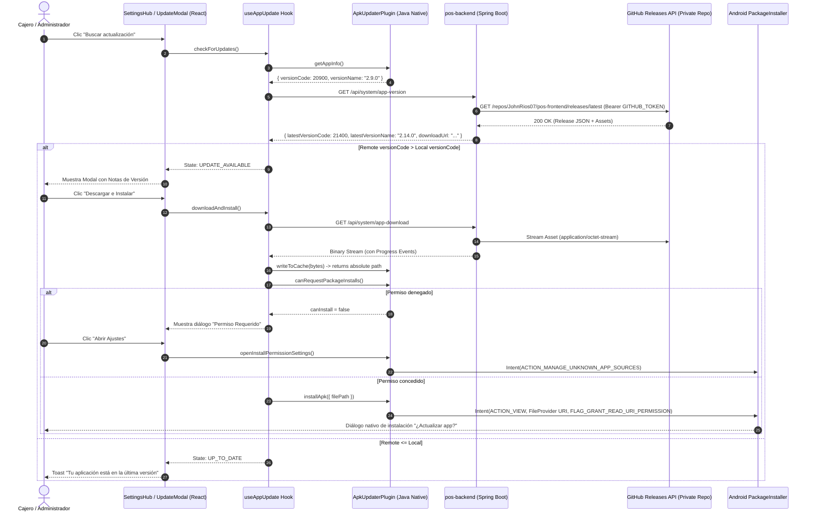

# Design: In-App APK Updater for Private POS Deployment

## Change ID
`in-app-apk-updater`

---

## 1. Architectural Overview

The solution bridges three layers without introducing third-party unmaintained dependencies or leaking GitHub tokens to client terminals:



---

## 2. Backend Design (`pos-backend`)

### 2.1 Package: `com.company.pos.distribution`
Following Hexagonal/Clean Architecture:
- `application`:
  - `AppUpdateService`: Handles GitHub release API calls, caching with a 5-minute TTL, parsing asset URLs, and streaming the binary.
  - `dto.AppVersionResponse`:
    ```java
    public record AppVersionResponse(
        String latestVersionName,
        Integer latestVersionCode,
        String downloadUrl,
        String releaseNotes,
        boolean mandatory,
        Instant publishedAt,
        Long fileSizeBytes
    ) {}
    ```
- `infrastructure.web`:
  - `AppDistributionController`: Exposes `/api/system/app-version` and `/api/system/app-download`.
- `infrastructure.config`:
  - `GitHubDistributionProperties`:
    ```java
    @ConfigurationProperties(prefix = "app.distribution.github")
    public record GitHubDistributionProperties(
        String token,
        String repository, // "JohnRios07/pos-frontend"
        Duration cacheTtl
    ) {}
    ```

### 2.2 Security Configuration Update
In `com.company.pos.auth.infrastructure.security.SecurityConfig`:
```java
.requestMatchers("/api/system/app-version", "/api/system/app-download").permitAll()
```
This guarantees that devices running outdated versions with invalidated JWTs can still self-update.

### 2.3 Streaming Strategy
Rather than buffering a 4–10MB `.apk` in server memory, `AppDistributionController` pipes the `InputStream` from GitHub's raw asset URL directly to the Spring `ResponseEntity<StreamingResponseBody>`:
```java
@GetMapping("/app-download")
public ResponseEntity<StreamingResponseBody> downloadApk() {
    return appUpdateService.streamLatestApk();
}
```

---

## 3. Android Native Design (`pos-frontend/android`)

### 3.1 Permissions & FileProvider
In `pos-frontend/android/app/src/main/AndroidManifest.xml`:
```xml
<!-- Required for initiating APK installation on Android 8.0+ (API 26+) -->
<uses-permission android:name="android.permission.REQUEST_INSTALL_PACKAGES" />
```

In `pos-frontend/android/app/src/main/res/xml/file_paths.xml`:
```xml
<paths xmlns:android="http://schemas.android.com/apk/res/android">
    <external-path name="my_images" path="." />
    <cache-path name="my_cache" path="." />
</paths>
```

### 3.2 Native Plugin: `ApkUpdaterPlugin.java`
Located in `app.rvpos.pos.ApkUpdaterPlugin`:
```java
@CapacitorPlugin(name = "ApkUpdater")
public class ApkUpdaterPlugin extends Plugin {

    @PluginMethod
    public void getAppInfo(PluginCall call) {
        try {
            Context ctx = getContext();
            PackageInfo pInfo = ctx.getPackageManager().getPackageInfo(ctx.getPackageName(), 0);
            long versionCode = Build.VERSION.SDK_INT >= Build.VERSION_CODES.P 
                ? pInfo.getLongVersionCode() 
                : pInfo.versionCode;
            JSObject ret = new JSObject();
            ret.put("versionCode", versionCode);
            ret.put("versionName", pInfo.versionName);
            ret.put("packageName", ctx.getPackageName());
            call.resolve(ret);
        } catch (Exception e) {
            call.reject("Error fetching package info: " + e.getMessage());
        }
    }

    @PluginMethod
    public void canRequestPackageInstalls(PluginCall call) {
        if (Build.VERSION.SDK_INT >= Build.VERSION_CODES.O) {
            boolean canInstall = getContext().getPackageManager().canRequestPackageInstalls();
            JSObject ret = new JSObject();
            ret.put("canInstall", canInstall);
            call.resolve(ret);
        } else {
            JSObject ret = new JSObject();
            ret.put("canInstall", true);
            call.resolve(ret);
        }
    }

    @PluginMethod
    public void openInstallPermissionSettings(PluginCall call) {
        if (Build.VERSION.SDK_INT >= Build.VERSION_CODES.O) {
            Intent intent = new Intent(Settings.ACTION_MANAGE_UNKNOWN_APP_SOURCES);
            intent.setData(Uri.parse("package:" + getContext().getPackageName()));
            intent.addFlags(Intent.FLAG_ACTIVITY_NEW_TASK);
            getContext().startActivity(intent);
            call.resolve();
        } else {
            call.resolve();
        }
    }

    @PluginMethod
    public void installApk(PluginCall call) {
        String filePath = call.getString("filePath");
        File file = new File(filePath);
        if (!file.exists()) {
            call.reject("APK file does not exist at " + filePath);
            return;
        }

        try {
            Uri contentUri = FileProvider.getUriForFile(
                getContext(),
                getContext().getPackageName() + ".fileprovider",
                file
            );

            Intent intent = new Intent(Intent.ACTION_VIEW);
            intent.setDataAndType(contentUri, "application/vnd.android.package-archive");
            intent.addFlags(Intent.FLAG_GRANT_READ_URI_PERMISSION);
            intent.addFlags(Intent.FLAG_ACTIVITY_NEW_TASK);
            getContext().startActivity(intent);
            call.resolve();
        } catch (Exception e) {
            call.reject("Failed to trigger installation: " + e.getMessage());
        }
    }
}
```

Registered in `MainActivity.java`:
```java
@Override
public void onCreate(Bundle savedInstanceState) {
    registerPlugin(ApkUpdaterPlugin.class);
    super.onCreate(savedInstanceState);
}
```

---

## 4. Frontend Design (`pos-frontend`)

### 4.1 Native Plugin Types: `src/plugins/apkUpdater.ts`
```typescript
import { registerPlugin } from '@capacitor/core';

export interface AppInfo {
  versionCode: number;
  versionName: string;
  packageName: string;
}

export interface ApkUpdaterPlugin {
  getAppInfo(): Promise<AppInfo>;
  canRequestPackageInstalls(): Promise<{ canInstall: boolean }>;
  openInstallPermissionSettings(): Promise<void>;
  installApk(options: { filePath: string }): Promise<void>;
}

export const ApkUpdater = registerPlugin<ApkUpdaterPlugin>('ApkUpdater');
```

### 4.2 Hook: `src/hooks/useAppUpdate.ts`
Manages:
- Version comparison between native `versionCode` and backend `latestVersionCode`.
- Download through `fetch` with `ReadableStream` to calculate progress percentage (`(loaded / total) * 100`).
- Writing downloaded chunk array to native cache directory using `@capacitor/filesystem` (or direct helper).
- Permission gating before invoking `ApkUpdater.installApk()`.

### 4.3 UI Component: `src/components/updates/AppUpdateModal.tsx`
- Dialog displaying:
  - Version diff (`v2.9.0` -> `v2.14.0`).
  - Formatted Release Notes.
  - Interactive progress indicator:
    - Downloading: Progress bar with `3.2 MB / 3.9 MB (82%)`.
    - Ready: Primary button "Instalar actualización".
    - Permission prompt: Alert with "Abrir Configuración de Android".

---

## 5. Security & Invariant Verification

1. **Zero Secret Leaks:** No GitHub Personal Access Token is bundled into the React build or APK. All GitHub requests are authenticated via backend secrets.
2. **Keystore Consistency:**
   - Production builds MUST be signed with `ANDROID_KEYSTORE_BASE64` configured in GitHub Actions.
   - Debug builds cannot be upgraded directly from a production-signed build due to Android OS signature validation.
3. **Graceful Degeneration:** On Web browsers, the updater component reports that it is running in Web mode and disables the native APK installation triggers.
